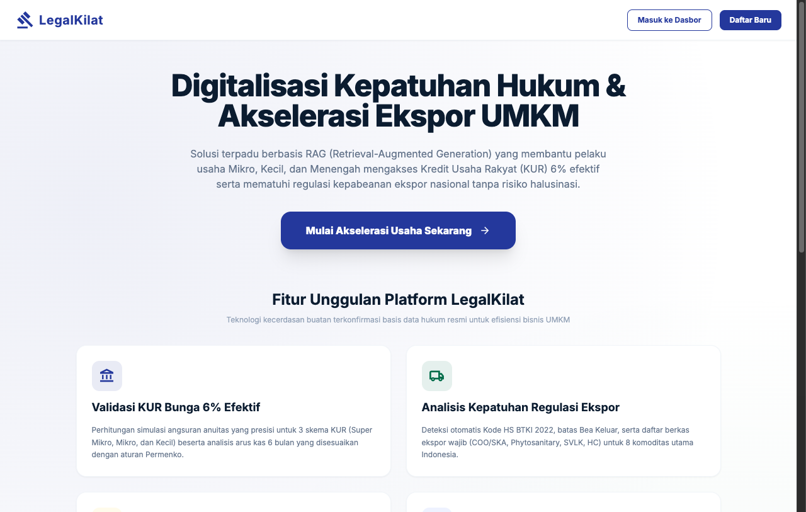
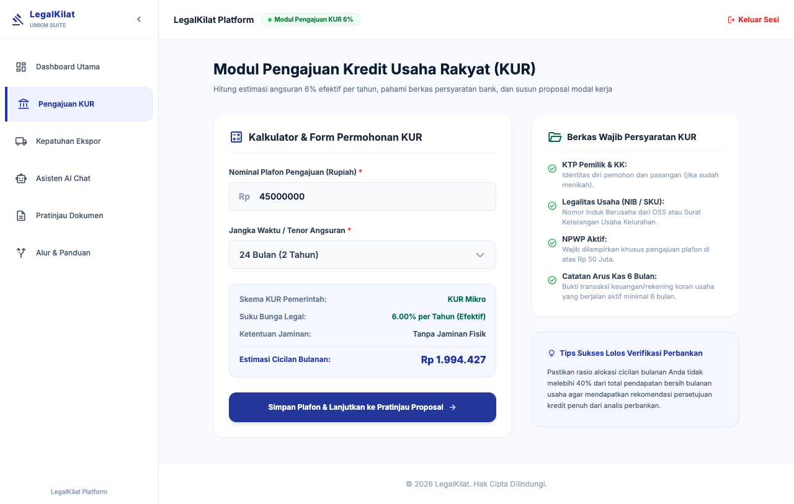
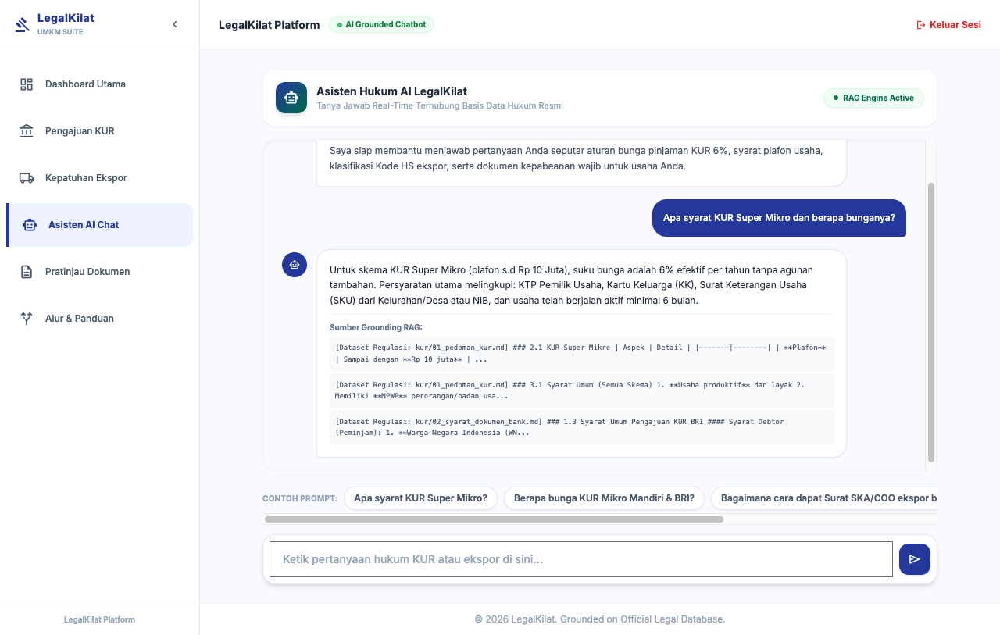

# LegalKilat

Asisten kepatuhan untuk UMKM Indonesia yang ingin mengajukan **KUR (Kredit Usaha Rakyat)** dan **ekspor**: kalkulator cicilan, pemeriksaan kelayakan proposal, pemetaan komoditas ke kode HS, dan tanya-jawab berbasis retrieval (RAG) atas basis pengetahuan regulasi yang kecil dan terkurasi.

Dibuat sebagai prototipe untuk **IDCamp Developer Challenge #2** (partisipan). Ini adalah MVP hackathon, bukan produk produksi.

> **Bukan nasihat hukum atau keuangan.** Isi basis pengetahuan adalah ringkasan informasi publik pada saat disusun dan dapat sudah usang (mis. suku bunga, plafon, tarif bea keluar). Selalu verifikasi ke sumber resmi (kur.ekon.go.id, insw.go.id, customs.go.id) dan bank penyalur / Bea Cukai sebelum mengambil keputusan.

## Screenshot

| Landing | Simulasi KUR | Chat RAG |
|---|---|---|
|  |  |  |

Lainnya: [login](docs/screenshots/02-login.png), [analisis ekspor](docs/screenshots/04-analisis-ekspor.png), [simulator RAG admin](docs/screenshots/06-admin-simulator.png).

## Masalah

- Pelaku UMKM kesulitan memahami syarat dan skema plafon KUR serta menghitung cicilannya.
- Klasifikasi kode HS, bea keluar, dan dokumen ekspor (NIB, PEB, SKA/COO, SVLK, fitosanitari) membingungkan.
- Chatbot umum tanpa rujukan sering memberi jawaban yang tidak sesuai aturan Indonesia.

## Solusi

1. **Kalkulator & validasi KUR**: menentukan skema (Super Mikro / Mikro / Kecil) dari plafon, menghitung cicilan anuitas 6% efektif, dan menghasilkan pratinjau proposal yang bisa dicetak ke PDF (html2pdf.js di sisi klien).
2. **Analisis ekspor**: memetakan 8 komoditas contoh (kopi, batik, kerajinan, kakao, teh, udang beku, furnitur bambu, alas kaki) ke kode KBLI/HS, bea keluar, dan dokumen wajib, plus draf commercial invoice.
3. **Chat RAG dengan guardrail**: menjawab pertanyaan seputar KUR/ekspor sambil menampilkan potongan sumber yang dirujuk; pertanyaan di luar topik ditolak.
4. **Panel admin**: simulator RAG untuk mencoba kueri, melihat konteks yang diambil, dan prompt yang dikompilasi.

## Pendekatan RAG

- **Korpus**: 251 chunk dari `rag/datasets/legal_database.html` (tabel/seksi HTML) dan 5 berkas markdown di `rag/datasets/`, dipotong oleh `loadAndChunkDatabase()` di `rag_engine.js`.
- **Retrieval hibrida**: skor sparse (kata kunci) selalu tersedia. Jika `HF_TOKEN` diset, ditambah dense embedding `sentence-transformers/all-MiniLM-L6-v2` via Hugging Face Inference API dengan skor `0.7 * cosine + 0.3 * sparse`.
- **Guardrail relevansi**: jika skor teratas di bawah ambang (0.25 sparse-only, 0.20 hybrid), kueri dianggap di luar lingkup, jawaban penolakan dikembalikan, dan sumber tidak ditampilkan.
- **Generasi jawaban**: **tidak ada LLM**. Jawaban disusun dari templat berbasis aturan (kata kunci) di `server.js`, dengan potongan hasil retrieval sebagai sumber/fallback. Artinya jawaban terkontrol dan tidak berhalusinasi, tetapi terbatas pada topik yang sudah ditulis templatnya.

## Sumber data dan lisensi

Basis pengetahuan (`rag/datasets/`) adalah **ringkasan tulisan sendiri** (bukan salinan massal) dari informasi publik berikut, ditulis ulang dalam bentuk tabel/poin:

| Topik | Sumber rujukan |
|---|---|
| Skema, plafon, suku bunga, syarat KUR | kur.ekon.go.id (Kemenko Perekonomian); Permenko No. 8/2019 jo. No. 15/2020 jo. No. 2/2021 |
| Syarat dokumen bank penyalur | Informasi publik bank penyalur (BRI, BNI) |
| Prosedur ekspor, PEB, INSW | insw.go.id, DJBC (customs.go.id), Kemendag, KemenkopUKM |
| Kode HS / BTKI | BTKI 2022, nomenklatur WCO HS 2022 (hanya kode dan tarif contoh, tanpa teks nomenklatur penuh) |

Peraturan perundang-undangan RI pada umumnya tidak dilindungi hak cipta (UU No. 28/2014 Pasal 43), namun ringkasan di repo ini tetap bisa tidak akurat atau kedaluwarsa. Dokumen sumber mentah (PDF Permenko, WCO HS) **tidak** disertakan di repo ini. Jika Anda mengetahui kekeliruan atau masalah lisensi, silakan buka issue.

## Stack

Node.js 18+ (diuji di Node 22), Express 4, express-session + connect-mongo, bcrypt, Mongoose (opsional), cheerio, dotenv; frontend HTML/CSS/JS vanilla; embedding opsional via Hugging Face Inference API.

## Menjalankan

```bash
git clone https://github.com/seppam/LegalKilat.git
cd LegalKilat
npm install
cp .env.example .env     # opsional; semua nilai punya fallback untuk dev lokal
npm start                # http://localhost:3000
```

Mode fallback (tanpa MongoDB dan tanpa `HF_TOKEN`): sesi disimpan di memori, retrieval hanya sparse, dan **hanya login admin yang tersedia** (registrasi/login pengguna biasa membutuhkan `MONGODB_URI` yang valid, jika tidak API mengembalikan 503).

Login admin untuk demo lokal: username `admin`, sandi dari `ADMIN_PASSWORD` (default dev `legalkilat2026` bila tidak diset). Halaman: `/dashboard/kur.html`, `/dashboard/ekspor.html`, `/dashboard/chat.html`, `/admin/simulator.html`. Pada `NODE_ENV=production`, server menolak start bila `SESSION_SECRET` atau `ADMIN_PASSWORD` kosong.

## Pengujian

```bash
npm test
```

Menjalankan dua suite (tanpa jaringan, tanpa DB, `HF_TOKEN` dipaksa placeholder):

- `test_rag.js`: validasi skema/plafon/KBLI, inisialisasi indeks RAG (sparse), pencarian, guardrail out-of-scope, input kosong.
- `test_server.js`: menjalankan `server.js` sebagai proses anak lalu menguji API lewat HTTP: proteksi auth (401/403), login admin benar/salah, `/api/rag-simulate`, `/api/chat-rag`, validasi input (400), dan penolakan start produksi tanpa rahasia.

## Keterbatasan

- Jawaban chat berbasis templat aturan, bukan LLM; cakupan topik sempit (KUR dan 8 komoditas contoh).
- Data bersifat snapshot dan belum diverifikasi ulang terhadap ketentuan terkini; angka KUR (6%, plafon) dan tarif bea keluar dapat berubah.
- Jalur dense embedding memakai endpoint `api-inference.huggingface.co`; endpoint Hugging Face dapat berubah dan jalur ini belum diverifikasi ulang dengan token nyata. Tanpa token, aplikasi tetap berfungsi dengan sparse retrieval.
- Pendaftaran/login pengguna butuh MongoDB. Tidak ada rate limiting, CSRF protection, atau audit keamanan penuh; jangan dipakai untuk data sensitif sungguhan.
- Akun admin tunggal berbasis sandi dari environment.

## Lisensi

Kode: [MIT](LICENSE). Konten dataset adalah ringkasan informasi publik pemerintah dan lembaga terkait; hak atas sumber aslinya tetap pada pemiliknya.
